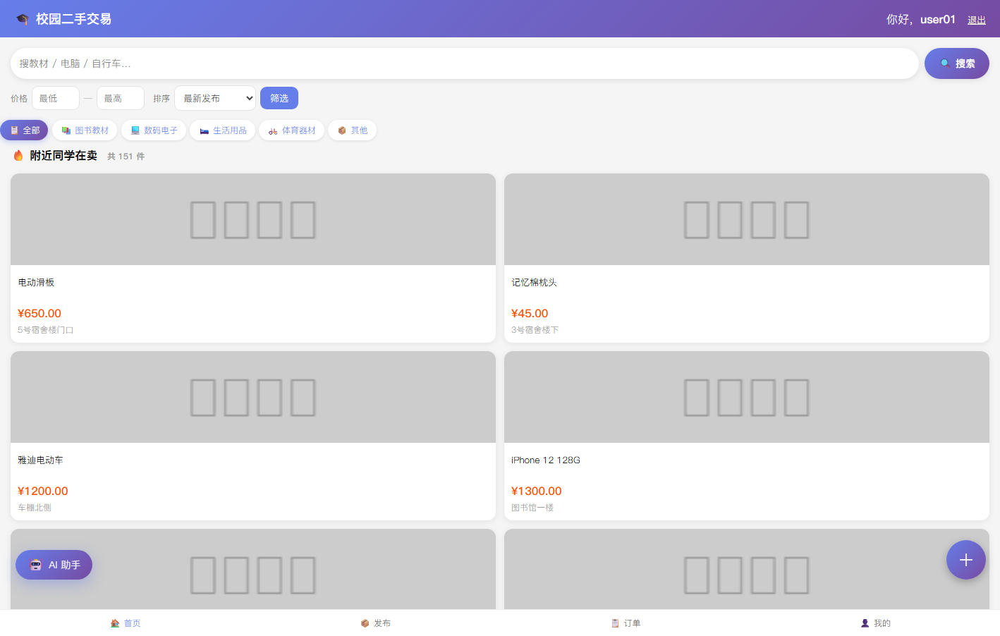
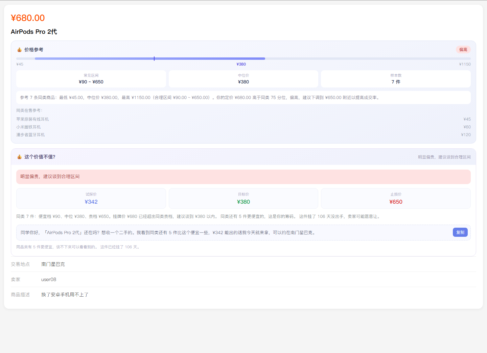
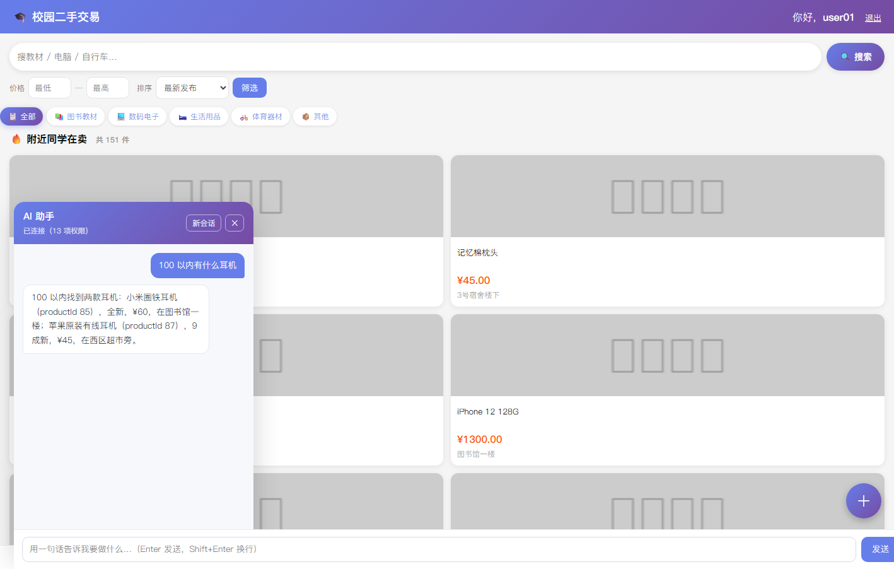
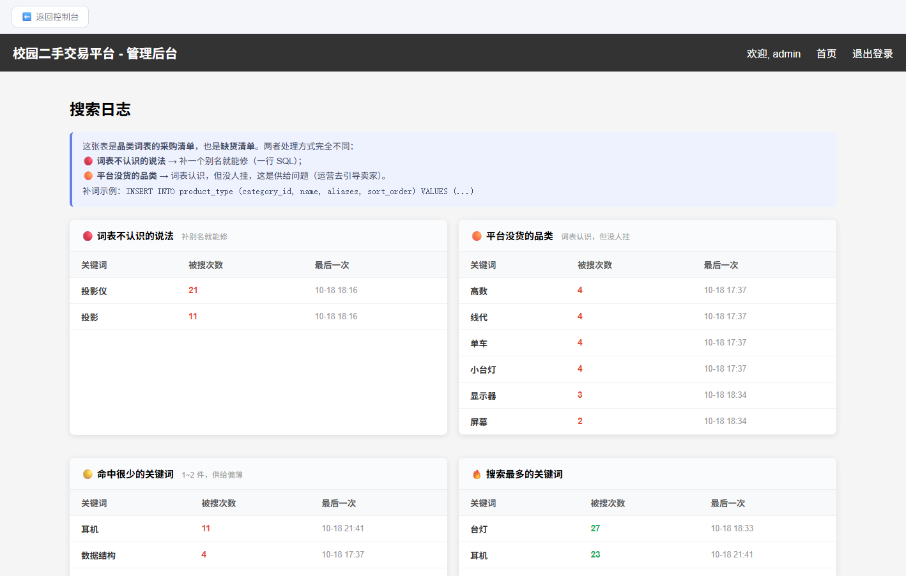

# 校园二手交易平台 · AI Agent 化

[](https://github.com/Maple127/campus-secondhand-agent/actions/workflows/ci.yml)
一个能跑的校园二手交易平台（Java），加一层受约束的 AI Agent（Python）。

**这个项目真正想回答的问题是：哪些事值得交给 Agent，哪些不值得——以及怎么证明。**

| 首页 · 搜索与筛选 | 商品页 · 比价 + 议价建议 |
|---|---|
|  |  |
| **AI 助手 · 自然语言检索** | **管理端 · 搜索日志驱动词表维护** |
|  |  |

---

## 它是什么

- **后端**（Java / Spring Boot）：商品、订单、审核、分类、举报，业务真值全在这里
- **Agent**（Python / FastAPI / LangGraph）：13 个工具（7 读 6 写），写操作必须人工确认
- **两者解耦**：Agent 只通过 REST 调后端，从不碰数据库；后端不依赖 Agent 也能跑

```
浏览器 ──► Java 后端（业务规则 / 状态机 / 权限 / 价格计算）
              ▲
              │ 只走 REST，双层令牌鉴权
           Python Agent（选工具、填参数、把结果说成人话）
```

---

## 三个核心结论（都有数据支撑）

### 1. Agent 不是万能的，边界是测出来的

30 条任务 × 3 组对照，程序化判分（不用模型自评）：

| 任务类型 | 搜索框 | AI 助手（改造前） | AI 助手（改造后） |
|---|---|---|---|
| **总成功率** | 63% | 87% | **97%**（29/30） |
| 找东西 | **88% / 10ms** | 75% | 100% / 7.3s |
| 多步任务 | 33% | 83% | **100%** |
| 写操作 | 20% | 80% | 80% |

**「找东西」这一档，agent 虽然也到了 100%，但用了 7.3 秒——搜索框 10 毫秒就够。**
所以结论不是「agent 更强」，而是：**单轮检索别用 agent，多步与写操作只有 agent 能做。**

### 2. 把结论变成代码，收益是量出来的

| 改动 | 效果 |
|---|---|
| 显式三路路由（REFUSE / FAST / AGENT） | 延迟 **−48.6%**、输入 token **−74.7%** |
| 品类词扩展 | 召回 **66.7% → 100%**（30 条标注查询） |
| 按 token 预算压缩历史 | 30 轮对话输入 token **−35.2%**，核心约束不丢 |

### 3. 试了才知道哪些设计是白干的

| 实验 | 结果 |
|---|---|
| 空结果重试闸门 | 确实拦截了，但工具调用数不变、token **反而 +25** |
| 后端全挂时重试 | **纯损失 +5.0 秒**，一次都没救回来 |

失败实验也原样写在文档里，见 [消融评测](docs/evaluation-ablation.md)。

---

## 快速开始

**前置**：JDK 21、Maven 3.9+、MySQL 8.0、Python 3.11（前端无构建，不需要 Node）。

```bash
# 1) 建库并灌演示数据（注意本项目连的是 IPv6 的 [::1]）
mysql -h ::1 -uroot -p123456 < infra/schema.sql
mysql -h ::1 -uroot -p123456 login_db < infra/seed.sql

# 2) 启动后端（8081）
cd backend && mvn spring-boot:run

# 3) 启动 Agent（8090，可选）
cd agent
python -m venv .venv
.venv/bin/pip install -r requirements.txt        # Windows: .venv\Scripts\pip
export DEEPSEEK_API_KEY=sk-...                   # Windows: $env:DEEPSEEK_API_KEY="sk-..."
.venv/bin/python -m uvicorn app.main:app --host 127.0.0.1 --port 8090
```

Windows 用户也可以直接跑 `.\infra\start-all.ps1` 一键启动两个服务。

打开 <http://localhost:8081>。演示账号：`user01 / pass123`，管理员 `admin / admin`。

> **Agent 是可选的**：没有 DeepSeek API Key 时，网页端与后端完全正常，
> 只是 AI 助手不会生成回答。这是刻意的——后端不能依赖一个大模型才能卖东西。

---

## 项目结构

```
backend/          Java 21 + Spring Boot 4.1 + Thymeleaf + JPA + MySQL
  ├─ api/web/     网页接口
  ├─ api/rest/    /api/v1（供 agent 调用；双层令牌 + scope）
  ├─ service/     业务真值：状态机、订单、比价、议价、品类词
  └─ security/    令牌与 scope 拦截
agent/            Python 3.11 + FastAPI + LangChain/LangGraph
  ├─ app/routing.py     显式路由（纯规则，可脱网测）
  ├─ app/fastpath.py    快路径：一次检索 + 一次生成
  ├─ app/memory.py      按 token 预算压缩历史
  ├─ app/guardrails.py  注入检测 + 不可信内容围栏
  ├─ app/metrics.py     进程内指标（/api/metrics）
  └─ eval/              30 条金标准任务 + 3 组对照
docs/             设计文档、评测报告、深入阅读、截图
infra/            建库脚本、种子数据、启动脚本、消融实验
```

---

## 测试

```bash
cd backend && mvn test      # 50 个单元测试（Mockito，不需要数据库）
cd agent   && pytest        # 115 个测试（Fake 模型，不需要 API Key）
                            # 端到端：infra/smoke-test.ps1，19 项断言
```

CI 在 `.github/workflows/ci.yml`：后端测试 + ruff + mypy + agent 测试。

---

## 文档

**从 [docs/README.md](docs/README.md) 开始**——它按"我想找什么"组织。

| 想了解 | 直接看 |
|---|---|
| 怎么跑起来 | [使用指南](docs/guide.md) |
| 后端业务规则 | [状态机 / 审核 / 并发 / 权限](docs/backend.md) |
| Agent 怎么设计 | [Agent 设计](docs/agent-design.md) · [人工确认](docs/agent-hitl.md) |
| 到底有没有用 | [价值评测](docs/evaluation-findings.md) · [消融评测](docs/evaluation-ablation.md) |
| 某个设计怎么权衡 | [路由](docs/deep-dives/routing.md) · [注入防护](docs/deep-dives/injection.md) · [议价](docs/deep-dives/negotiation.md) · [品类词](docs/deep-dives/product-types.md) |
| 哪里还站不住 | [已知限制](docs/limitations.md) · [面试自检表](docs/interview-map.md) |
| 这些数字能不能写简历 | [数字口径](docs/numbers.md) |

---

## 已知限制

- **没有部署**：只有本地运行，没有 Dockerfile 和线上地址
- **没有真实用户**：158 件商品是脚本生成的演示数据
- **单实例**：能力令牌与指标存在进程内，横向扩展需要换存储
- **评测是单次运行**：同一配置三次跑出 87/83/97，方差很大，没有做 pass^k
- **端到端没测瞬时故障**：重试的正收益只在单元测试里验证过

完整清单（含"做了但不够好""验证不足""结构性风险"）在 [已知限制](docs/limitations.md)。

---

## 技术栈

**后端** Java 21 · Spring Boot 4.1.0 · Spring Data JPA · Thymeleaf · MySQL 8.0 · Lombok · JUnit 5 + Mockito

**Agent** Python 3.11 · FastAPI · LangChain 1.x · LangGraph 1.x · SQLite checkpointer · DeepSeek · pytest · ruff · mypy

**前端** Thymeleaf 服务端渲染 + 原生 JS（无框架、无构建）

MIT License · 见 [LICENSE](LICENSE)
